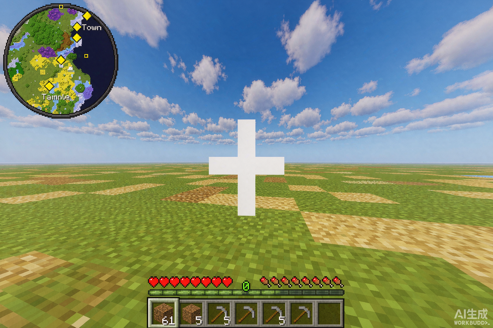

# 极简小地图 · 两套原生实现

<p align="center">
  
</p>


面向 Minecraft 的两套**彼此独立、功能边界一致**的「极简小地图」完整源码：

| 交付 | 目标 | 形态 | 状态 |
|---|---|---|---|
| A | Minecraft Java **1.21.11** / Java 21 | Fabric 客户端模组（client-only） | 已用 Gradle 9.8.2 + Loom 1.19.4 构建成功 |
| B | Minecraft Bedrock **1.21.130** | 行为包 + 资源包（脚本模块） | 已通过 33 项离线用例 |

所有版本坐标、API 符号、清单格式号均先于编码从官方页面核对，详见 [VERSION-EVIDENCE.md](VERSION-EVIDENCE.md)。如有「未证实」项则停止实现——本交付无未证实项。

## 效果预览

<p align="center">
  
</p>


## 功能边界（两套共同遵守）

- 主画面：屏幕角落的 2D 角标小地图；**只画**地形色块 + 玩家自己一个图标。
- 按键 `M`：仅打开「地点标记管理」，只支持添加 / 重命名 / 删除；不是第二张地图，不显示坐标面板或任何其他信息；关闭即释放。
- 迷雾：只显示已探索 / 已加载区域，未探索区域留空。
- 标记：仅本地用途，不共享、不多人同步。
- 其余功能一律不实现。

> Bedrock 侧因平台无按键绑定 API，`M` 键改为脚本命令 `/simplemap:markers`；这是有意偏离，详见 [docs/03-不可对齐项声明.md](docs/03-不可对齐项声明.md)。

## 目录结构

```
.
├── VERSION-EVIDENCE.md          # 版本核对表（官方 URL / 检索日期 / 渠道 / 正式或预览）
├── docs/
│   ├── 01-功能边界与实现说明.md
│   ├── 02-API白名单.md           # 每个 import/require 的官方出处
│   ├── 03-不可对齐项声明.md
│   └── 04-验证命令.md
├── fabric/                      # A：Fabric 客户端模组完整工程
│   ├── build.gradle / settings.gradle / gradle.properties
│   ├── gradlew / gradlew.bat / gradle/wrapper/
│   └── src/main/{java,resources}
└── bedrock/                     # B：基岩版 Add-on
    ├── behavior_pack/           # manifest + scripts/main.js
    ├── resource_pack/           # manifest + 图标
    └── tests/                   # 无需 npm 依赖的离线验证
```

## 快速验证

```bash
# A：Fabric
cd fabric && ./gradlew clean build      # 产物 build/libs/simple_minimap-1.0.0.jar

# B：Bedrock
node bedrock/tests/run.mjs              # 合计 PASS=33 FAIL=0
```

详见 [docs/04-验证命令.md](docs/04-验证命令.md)。

## 关于 r3 半成品的改进

本仓库并非附件 r3 的原样复刻，修正了如下问题：

1. **工具链版本错配**：Loader 0.19.5 → 0.20.1、Loom 1.17.20 → 1.19-SNAPSHOT、Gradle 9.3 → 9.8.2（Loom 1.19.4 要求 Gradle ≥ 9.8 且 JVM ≥ 25）；并补齐了缺失的 Gradle wrapper。
2. **宿主 JDK 写死**：删除 `gradle.properties` 中指向特定机器 `/opt/jdks/...` 的绝对路径，改用标准 toolchain。
3. **UTF-8 与转义**：保留并说明 `processResources` 的 UTF-8 / 逐行替换策略，确保中文描述在最终 JAR 中不损坏。
4. **HudRenderCallback 弃用**：按官方 Javadoc 的 `(DrawContext, RenderTickCounter)` 签名调用并加类级 `@SuppressWarnings`；不做 Mixin、不用 Screen.render 伪装。
5. **Bedrock 跨维度缓存串色**：探索缓存键加入维度 ID，避免主世界 / 下界 / 末地同一坐标互相覆盖。
6. **Bedrock 写入失败计数丢失**：重试失败时保留 dirty 计数，防止最后几秒数据丢失。
7. **文档缺口**：补齐 r3 源码注释中引用但不存在的 `docs/03-不可对齐项声明.md`。
8. **清单 UUID**：四个 UUID 全部现生成 v4，不复用 r3。
9. **pack.mcmeta 未证实格式号**：移除该文件（Fabric 官方模板不产出），避免写入无法从允许来源核实的资源包格式号。

## 许可

MIT，见 [LICENSE](LICENSE)。
